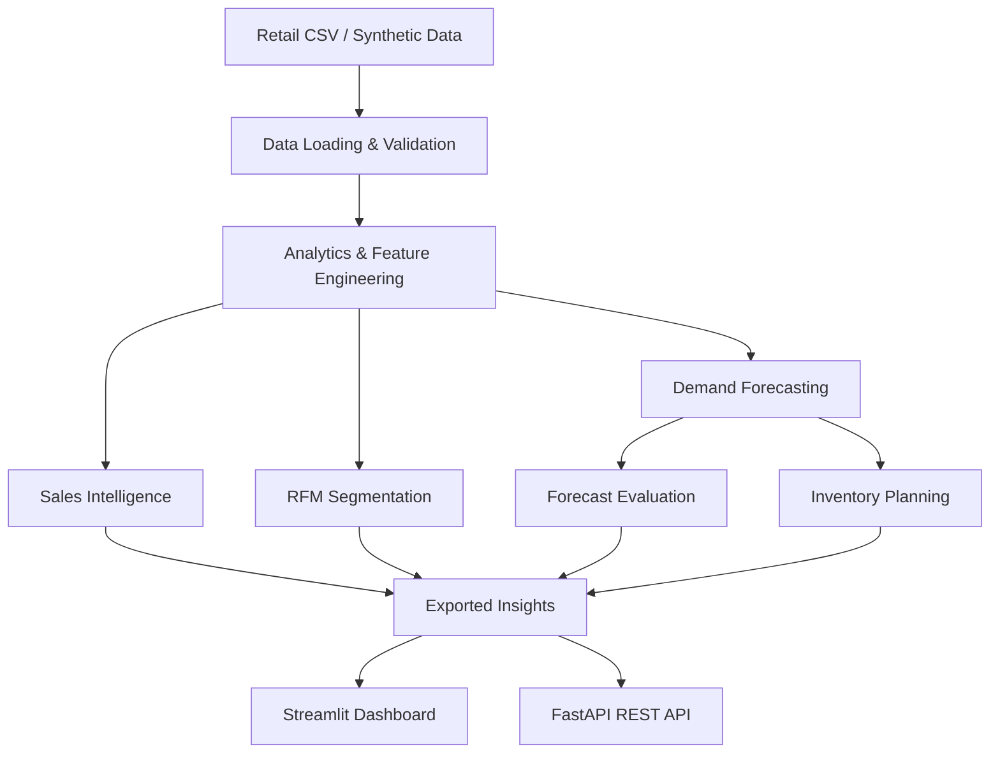

# 🛍️ Retail AI Sales Intelligence

### Turn Retail Data Into Smarter Business Decisions With AI

**An end-to-end retail analytics and machine learning platform** for sales intelligence, demand forecasting, customer segmentation, and inventory optimization — powered by Python, Streamlit, scikit-learn, and FastAPI.

<p align="center">

  
  
  
  
  

</p>

<p align="center">
  <b>📊 Sales Analytics · 🔮 Demand Forecasting · 👥 Customer Intelligence · 📦 Inventory Planning</b>
</p>

---

## 🌟 About the Project

Retail businesses generate valuable data every day, but turning that data into actionable decisions can be challenging.

**Retail AI Sales Intelligence** helps bridge that gap by transforming transaction data into interactive visualizations, machine learning predictions, and practical business recommendations.

Explore sales performance, forecast future product demand, discover meaningful customer groups, and identify inventory replenishment needs — all from one unified platform.

Built with a modular architecture, the project includes an interactive Streamlit dashboard, an end-to-end ML pipeline, and a FastAPI service for integrating insights into other applications.

## ✨ Key Features

| Feature | What it does |
|---|---|
| 📊 Sales Intelligence | Analyze revenue, orders, gross profit, and daily sales trends. |
| 🔮 Demand Forecasting | Predict future product demand using a random forest model and historical demand features. |
| 👥 Customer Segmentation | Group customers using RFM analysis and K-means clustering. |
| 📦 Inventory Optimization | Estimate safety stock, reorder points, stock coverage, and replenishment quantities. |
| 📈 Forecast Evaluation | Evaluate predictions using MAE, RMSE, WAPE, and non-zero-day MAPE. |
| 📁 CSV Data Upload | Analyze compatible retail datasets with schema validation. |
| ⚙️ ML Pipeline | Run analytics, segmentation, forecasting, evaluation, and inventory planning in one workflow. |
| 🔌 REST API | Access sales, forecasts, customer segments, and inventory recommendations. |
| 📤 Exportable Results | Save analytical outputs as CSV and JSON files. |

## 🧠 Machine Learning & Analytics

### 🔮 1. Demand Forecasting

Forecast product-level demand using a supervised machine learning approach.

**Model features include:**
- Historical demand lags: 1, 7, 14, 28, and 364 days.
- Rolling demand statistics.
- Day-of-week and annual calendar features.
- Zero-demand days to represent periods without sales.
- Chronological train/test evaluation.
- Recursive multi-day forecasts.
- Empirical prediction bands based on holdout errors.

**Evaluation metrics:** MAE, RMSE, WAPE, and non-zero-day MAPE.

The forecasting module helps users explore expected demand and compare model performance against observed demand.

### 👥 2. Customer Segmentation Using RFM

Understand customer purchasing behavior through three key measures:

- **Recency:** How recently a customer purchased.
- **Frequency:** How many distinct orders a customer placed.
- **Monetary:** How much revenue the customer generated.

The system transforms and scales customer features before applying K-means clustering.

Potential customer groups include:

- 🏆 Champions
- 💎 Loyal Customers
- 🌱 Recent Customers
- ⚠️ At-Risk High-Value Customers
- 💰 High-Spend Customers
- 🤝 Customers Needing Nurturing

Segment labels are heuristic interpretations of cluster behavior, not trained predictions of customer churn.

### 📦 3. Inventory Planning

Convert demand estimates into practical replenishment recommendations.

The inventory module estimates:

- Average daily demand and demand variability.
- Safety stock based on a selected service level.
- Reorder points based on supplier lead time.
- Target inventory and suggested replenishment quantities.
- Days of inventory cover.
- Approximate stockout risk and stock priority.

These recommendations provide a starting point for purchasing and replenishment decisions.

### 📊 4. Revenue & Sales Insights

Explore business performance using sales KPIs and visual analytics.

Analyze revenue trends, order activity, gross profit, customer behavior, and product demand to identify patterns that deserve further investigation.

Price elasticity is not yet implemented as a validated model.

## 🖥️ Interactive Dashboard

The Streamlit application provides a multi-page interface for exploring retail data and model outputs.

| Dashboard area | Purpose |
|---|---|
| 🏠 Sales Overview | Business KPIs and sales trends |
| 🔮 Demand Forecasting | Product forecasts and backtesting results |
| 👥 Customer Intelligence | RFM profiles, customer groups, and customer exploration |
| 📦 Inventory Planning | Reorder recommendations and stock risk |

> **Dashboard preview:** Add screenshots of the Sales Overview, Demand Forecasting, Customer Intelligence, and Inventory Planning pages here after running the application.

To add a screenshot, create an `assets/` folder and save your images there. Then use Markdown such as:

``

## 🏗️ System Architecture



### Technology Stack

| Layer | Technologies |
|---|---|
| Programming | Python 3.11+ |
| Data processing | Pandas 3.x, NumPy |
| Machine learning | scikit-learn |
| Dashboard | Streamlit |
| Visualization | Plotly |
| REST API | FastAPI, Uvicorn |
| Data validation | Pandas-based schema checks and Pydantic |
| Testing | pytest |
| Output formats | CSV, JSON |

## 📂 Project Structure

```text
retail-ai-sales-intelligence/
│
├── app/
│   ├── Home.py
│   └── pages/
│       ├── 1_Sales_Overview.py
│       ├── 2_Customer_Intelligence.py
│       ├── 3_Demand_Forecasting.py
│       └── 4_Inventory_Planning.py
│
├── api/
│   └── main.py
│
├── src/
│   └── retail_ai/
│       ├── data_loader.py
│       ├── data_generator.py
│       ├── forecasting.py
│       ├── segmentation.py
│       ├── inventory.py
│       └── pipeline.py
│
├── tests/
│   ├── test_forecasting.py
│   ├── test_segmentation.py
│   ├── test_inventory.py
│   └── test_pipeline.py
│
├── data/
│   └── retail_transactions.csv
│
├── artifacts/
├── generate_data.py
├── requirements.txt
├── README.md
└── .gitignore
```

*The exact filenames may vary slightly by project version.*

## 🚀 Getting Started

Follow these steps to run the application locally.

### Prerequisites

- Python 3.11 or newer.
- Git.
- Visual Studio Code or another Python editor.
- Internet access for the initial dependency installation.

### 1. Clone the repository

Replace `YOUR_USERNAME` with your GitHub username.

```bash
git clone https://github.com/YOUR_USERNAME/retail-ai-sales-intelligence.git
cd retail-ai-sales-intelligence
```

### 2. Create a virtual environment

**Windows PowerShell**

```powershell
py -3.11 -m venv .venv
.\.venv\Scripts\Activate.ps1
```

**macOS / Linux**

```bash
python3 -m venv .venv
source .venv/bin/activate
```

### 3. Install dependencies

```bash
python -m pip install --upgrade pip
pip install -r requirements.txt
```

### 4. Generate synthetic retail data

```bash
python generate_data.py
```

This generates demonstration data for exploring the dashboard and testing the analytics pipeline.

If your repository already includes a compatible sample CSV, follow the generator's instructions before overwriting existing data.

### 5. Launch the dashboard

```bash
streamlit run app/Home.py
```

Open the local URL printed in your terminal, normally:

**http://localhost:8501**

### 6. Start the REST API

Open another terminal in the project root and activate the same virtual environment.

```bash
uvicorn api.main:app --reload
```

API base URL:

**http://localhost:8000**

Interactive API documentation:

**http://localhost:8000/docs**

## ⚙️ Run the Integrated ML Pipeline

Run the end-to-end analytics workflow:

```bash
python -m src.retail_ai.pipeline \
  --forecast-products 5 \
  --forecast-horizon 30 \
  --backtest-days 28 \
  --clusters 4 \
  --lead-time-days 7 \
  --service-level 0.95
```

**Available parameters**

| Parameter | Description | Example |
|---|---|---|
| `--input` | Path to a compatible retail CSV | `data/retail_transactions.csv` |
| `--output-dir` | Directory for generated results | `artifacts` |
| `--forecast-products` | Number of products to forecast | `5` |
| `--forecast-horizon` | Forecast horizon in days | `30` |
| `--backtest-days` | Number of historical holdout days | `28` |
| `--clusters` | Number of customer clusters | `4` |
| `--lead-time-days` | Assumed supplier lead time | `7` |
| `--service-level` | Target inventory service level | `0.95` |

### Pipeline outputs

The pipeline writes results to `artifacts/` by default.

| Output file | Contents |
|---|---|
| `sales_summary.json` | Sales KPIs and summary statistics |
| `customer_segments.csv` | Customer-level RFM assignments |
| `customer_segment_profiles.csv` | Segment-level summaries |
| `demand_forecasts.csv` | Forecasted product demand |
| `forecast_backtests.csv` | Historical actual-versus-predicted results |
| `forecast_metrics.csv` | Forecast evaluation metrics |
| `inventory_plan.csv` | Stock and replenishment recommendations |
| `pipeline_manifest.json` | Pipeline execution metadata |

## 🔌 REST API Reference

The FastAPI service exposes analytical results for use by external applications.

| Method | Endpoint | Purpose |
|---|---|---|
| `GET` | `/health` | Check API health |
| `GET` | `/sales/summary` | Retrieve sales KPIs |
| `GET` | `/sales/daily` | Retrieve daily sales data |
| `GET` | `/forecast/demand` | Generate product demand forecasts |
| `GET` | `/customers/segments` | Retrieve RFM customer segmentation |
| `GET` | `/inventory/plan` | Generate inventory recommendations |

### Example: Retrieve sales summary

```bash
curl http://localhost:8000/sales/summary
```

### Example: Forecast product demand

```bash
curl "http://localhost:8000/forecast/demand?product_id=P001&horizon_days=30&backtest_days=28"
```

### Example: Retrieve customer segments

```bash
curl "http://localhost:8000/customers/segments?n_clusters=4"
```

### Example: Get inventory recommendations

```bash
curl "http://localhost:8000/inventory/plan?lead_time_days=7&service_level=0.95"
```

For available query parameters, response schemas, and interactive testing, visit `/docs`.

## 📄 Data Format

The application expects a retail transaction CSV with the following required columns:

| Column | Description |
|---|---|
| `order_id` | Unique order identifier |
| `order_date` | Transaction date |
| `customer_id` | Customer identifier |
| `product_id` | Product identifier |
| `category` | Product category |
| `quantity` | Units purchased |
| `unit_price` | Selling price per unit |
| `unit_cost` | Cost per unit |
| `region` | Sales region |
| `inventory_on_hand` | Recorded inventory quantity |

Each row represents a product line in an order.

**Revenue calculation:**

`Revenue = quantity × unit_price`

Uploaded files must follow the expected schema and use valid dates and numeric values.

## 🧪 Run Tests

Run the automated test suite from the project root:

```bash
python -m pytest -v
```

The tests cover the forecasting, segmentation, inventory, and integrated pipeline components included in the repository.

## ⚠️ Modeling Limitations

This project is an analytical prototype and a foundation for further development.

- **Synthetic data:** Demonstration results do not represent real retail performance.
- **Forecast accuracy:** Chronological holdout metrics alone do not establish production reliability. Compare with seasonal-naive baselines and use multiple rolling-origin backtests.
- **Prediction intervals:** Empirical holdout-error bands are not guaranteed to achieve a particular statistical coverage.
- **Customer churn:** RFM segmentation is descriptive. A validated churn classifier requires a clearly defined future churn outcome and appropriate historical training labels.
- **Price insights:** Causal price elasticity requires suitable price variation, experimental data, or a carefully controlled observational analysis.
- **Inventory planning:** Current estimates rely on simplified demand assumptions and recorded inventory values. Production use requires reliable stock snapshots, supplier lead-time history, and relevant purchasing constraints.

Use model outputs as decision-support information rather than guaranteed predictions.

## 🔮 Future Enhancements

- [ ] Train and validate a customer churn prediction model.
- [ ] Add customer-level churn risk explanations.
- [ ] Implement price elasticity analysis and promotion evaluation.
- [ ] Compare forecasting models against seasonal-naive baselines.
- [ ] Add rolling-origin backtesting and forecast calibration.
- [ ] Connect to a live database or retail POS system.
- [ ] Add authentication and role-based API access.
- [ ] Deploy the dashboard and API to a cloud platform.
- [ ] Add monitoring for data quality and model performance.

## 🤝 Contributing

Contributions, ideas, and improvements are welcome!

1. Fork the repository.
2. Create a feature branch.
3. Implement and test your changes.
4. Submit a pull request with a clear description.

Please avoid committing credentials, private datasets, virtual environments, or generated files that should not be version-controlled.

## 👨‍💻 Author

**Adnan Khan**

BCA Student | Aspiring Data Scientist & AI/ML Engineer

Interested in machine learning, data analytics, software development, and building practical AI-powered solutions.

- GitHub: [@Adnan-khan04](https://github.com/Adnan-khan04)
- LinkedIn: [adnankhan-tech](https://www.linkedin.com/adnankhan-tech)

## 📜 License

Choose and add an appropriate open-source license before publishing the repository. For example, the MIT License can be suitable for projects intended for broad reuse, provided you are comfortable with its terms.

---

<p align="center">
  <b>⭐ If you find this project useful, consider giving the repository a star!</b>
  <br/>
  Built with Python, machine learning, and a passion for turning data into decisions.
</p>
